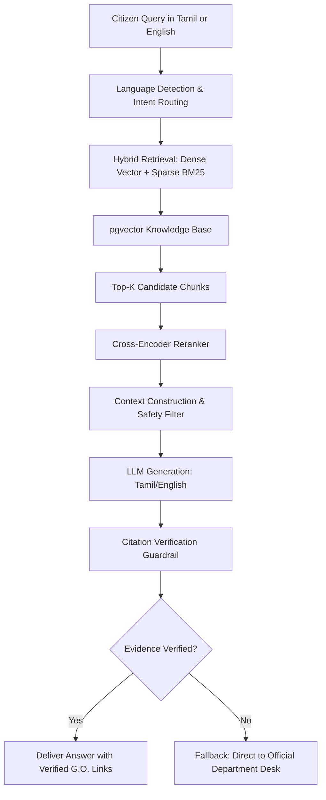

# GovAI Nexus – AI, RAG & Multi-Agent Architecture

## 1. RAG (Retrieval-Augmented Generation) Workflow
GovAI Nexus provides citizen answers strictly grounded in official Government Orders (G.O.s), policy gazettes, and citizen charters. The pipeline prevents AI hallucinations:

## 2. Tamil Nadu Multilingual NLP & Speech
- **Bilingual Core:** Full native handling of Tamil (தமிழ்) and English queries.
- **Transliteration & Code-Mixing:** Handles Tanglish (Tamil written in Latin alphabet, e.g., *"caste certificate eppadi apply panradhu"*).
- **Speech-to-Text & TTS:** Integration points with Whisper-compatible Indic models and Bhashini API for voice accessibility.

## 3. Intelligent Document Processing (IDP) Pipeline
- **Engines:** PaddleOCR (high accuracy on Indian fonts and Tamil script) and Tesseract OCR fallback.
- **Workflow:** 
  1. Image preprocessing (deskewing, binarization, noise removal).
  2. Layout detection (locating seals, signatures, header emblems).
  3. Structured field extraction (Applicant Name, Father's Name, DOB, Certificate No, Issue Date).
  4. Confidence Scoring: Fields with confidence < 80% are highlighted for mandatory human employee verification.

## 4. Multi-Agent Orchestration Framework
Nine specialized Python agents operate with defined permission boundaries:
1. **Orchestrator Agent:** Interprets requests and coordinates specialist agents.
2. **Citizen Service Agent:** Recommends services and guides step-by-step applications.
3. **Knowledge Retrieval Agent:** Executes semantic retrieval on verified policy store.
4. **Document Intelligence Agent:** Validates uploaded PDF/JPEG documents.
5. **Complaint Management Agent:** Classifies grievances and drafts priority routing.
6. **Analytics Agent:** Generates departmental operational summaries.
7. **Fraud Intelligence Agent:** Runs anomaly heuristics on high-risk application clusters.
8. **Language & Translation Agent:** Translates policies between Tamil and English.
9. **Governance Monitoring Agent:** Audits AI outputs and ensures human oversight.

*Strict Principle:* AI agents are decision-support tools only. Final statutory approvals or rejections are strictly reserved for authorized government officers.
