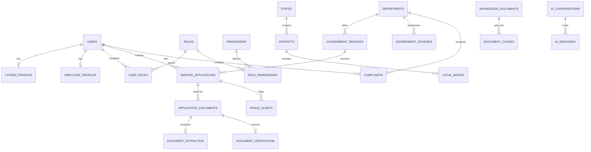

# GovAI Nexus – Database Architecture & Data Model

## 1. Database Philosophy & Technology Selection
- **Primary RDBMS:** PostgreSQL 16+
- **Vector Search:** `pgvector` extension (HNSW index on vector embeddings)
- **Cache & Ephemeral Storage:** Redis 7+
- **ORM:** SQLAlchemy 2.0 (AsyncIO)
- **Migrations:** Alembic with version-controlled revisions

## 2. Entity Relationship Overview (Logical Groups)

## 3. Complete Table Inventory (43 Tables)

### Group A: Identity & Access Management (IAM)
1. `users` (id, email, phone_number, hashed_password, user_type, is_active, preferred_language, created_at, updated_at)
2. `citizen_profiles` (id, user_id, full_name_en, full_name_ta, date_of_birth, gender, address_line, district_id, pincode, income_slab, community)
3. `employee_profiles` (id, user_id, employee_code, department_id, designation, office_location)
4. `roles` (id, name, code, description)
5. `permissions` (id, name, code, module, description)
6. `user_roles` (id, user_id, role_id)
7. `role_permissions` (id, role_id, permission_id)
8. `user_sessions` (id, user_id, refresh_token, ip_address, user_agent, expires_at)
9. `consent_records` (id, user_id, purpose, consented, consent_version, timestamp)

### Group B: Tamil Nadu Geography & Department Hierarchy
10. `states` (id, name_en, name_ta, code)
11. `districts` (id, state_id, name_en, name_ta, headquarters)
12. `local_bodies` (id, district_id, name_en, name_ta, body_type)
13. `departments` (id, name_en, name_ta, code, description, hod_name, contact_email)
14. `department_employees` (id, department_id, user_id, role_in_department, is_active)

### Group C: Government Services & Welfare Schemes
15. `government_services` (id, department_id, title_en, title_ta, category, description_en, description_ta, processing_time_days, service_fee, is_active)
16. `government_schemes` (id, department_id, title_en, title_ta, category, benefit_summary_en, benefit_summary_ta, application_deadline, is_active)
17. `scheme_eligibility` (id, scheme_id, criteria_key, criteria_operator, criteria_value)
18. `service_requirements` (id, service_id, document_name_en, document_name_ta, is_mandatory, allowed_formats)

### Group D: Application & Document Workflows
19. `service_applications` (id, application_number, user_id, service_id, district_id, current_status, assigned_employee_id, form_data, submitted_at, last_updated_at)
20. `application_documents` (id, application_id, document_type, file_path, file_size_bytes, mime_type, verification_status, created_at)
21. `document_extraction` (id, document_id, extracted_text, extracted_fields, confidence_score, ocr_engine, processed_at)
22. `document_verification` (id, document_id, verifier_user_id, is_approved, remarks, verified_at)
23. `application_status_history` (id, application_id, previous_status, new_status, changed_by_user_id, remarks, changed_at)

### Group E: Grievance & Complaint Management
24. `complaints` (id, complaint_number, user_id, department_id, district_id, category, subject, description, priority, status, assigned_officer_id, created_at, resolved_at)
25. `complaint_assignments` (id, complaint_id, assigned_to_user_id, assigned_by_user_id, assigned_at)
26. `complaint_updates` (id, complaint_id, action_taken, internal_notes, updated_by_user_id, timestamp)
27. `complaint_categories` (id, department_id, category_name_en, category_name_ta, sla_hours)

### Group F: AI, RAG & Vector Knowledge Base
28. `knowledge_documents` (id, title, department_id, source_url, category, version, language, is_verified, created_at)
29. `document_chunks` (id, knowledge_document_id, chunk_index, content, chunk_metadata, embedding_vector [VECTOR(1024)], created_at)
30. `ai_conversations` (id, user_id, session_title, language, created_at)
31. `ai_messages` (id, conversation_id, sender, text_content, citations, confidence_score, feedback_rating, created_at)
32. `ai_predictions` (id, model_name, model_version, prediction_type, target_entity, input_features, prediction_output, generated_at)
33. `model_registry` (id, model_name, version, task_type, weights_uri, evaluation_metrics, is_active, deployed_at)

### Group G: Fraud Intelligence & Open Governance
34. `fraud_alerts` (id, alert_number, related_entity_type, related_entity_id, risk_score, risk_category, evidence_summary, investigation_status, assigned_investigator_id, created_at)
35. `government_projects` (id, title_en, title_ta, department_id, district_id, allocated_budget_inr_cr, spent_budget_inr_cr, completion_percentage, status, start_date, target_completion_date)
36. `project_progress` (id, project_id, milestone_title, milestone_status, inspection_date, photographic_evidence_url)
37. `public_datasets` (id, title_en, title_ta, department_id, file_format, download_count, last_published_at)
38. `citizen_feedback` (id, user_id, service_id, rating, feedback_text, detected_sentiment, sentiment_confidence, created_at)
39. `sentiment_results` (id, batch_date, department_id, positive_count, neutral_count, negative_count, top_keywords)

### Group H: System Operations & Compliance
40. `notifications` (id, user_id, title_en, title_ta, message_en, message_ta, notification_type, is_read, created_at)
41. `audit_logs` (id, user_id, user_email, action, resource, resource_id, ip_address, status_code, timestamp)
42. `system_configuration` (id, config_key, config_value, environment, is_encrypted, updated_at)
43. `background_jobs` (id, job_type, payload, status, retry_count, error_trace, created_at, finished_at)

## 4. Indexing & Optimization Strategy
- **B-Tree Indexes:** On all foreign keys, email, phone_number, application_number, complaint_number, alert_number, and (department_id, current_status) composite keys.
- **HNSW Index:** On `document_chunks.embedding_vector` using `vector_cosine_ops` for sub-10ms nearest neighbor vector retrieval.
- **GIN Indexes:** On JSONB columns (`form_data`, `extracted_fields`) for dynamic attribute search.
