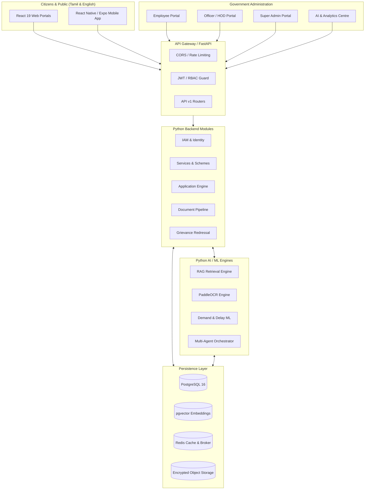
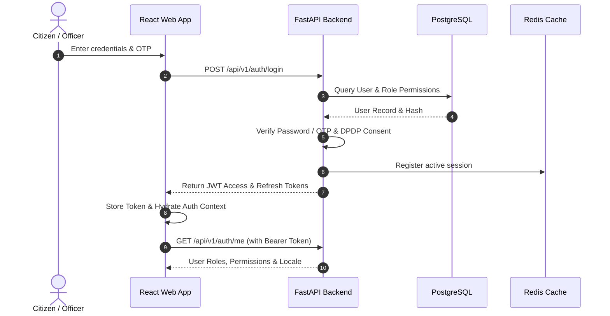
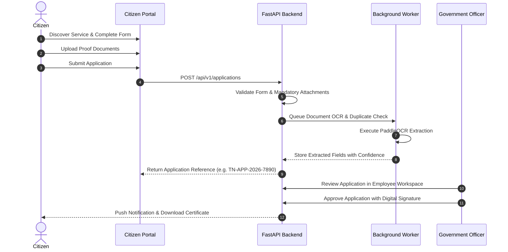
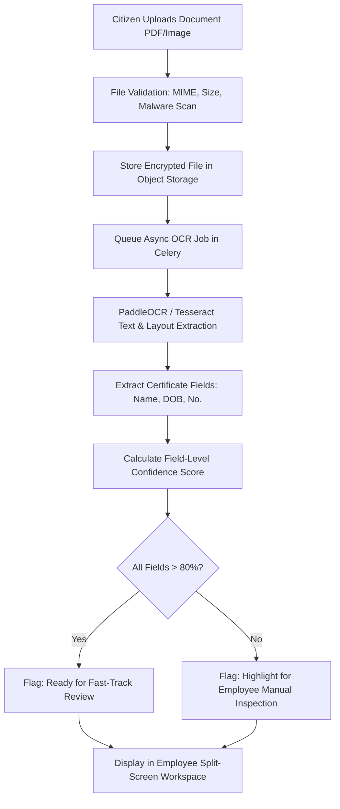
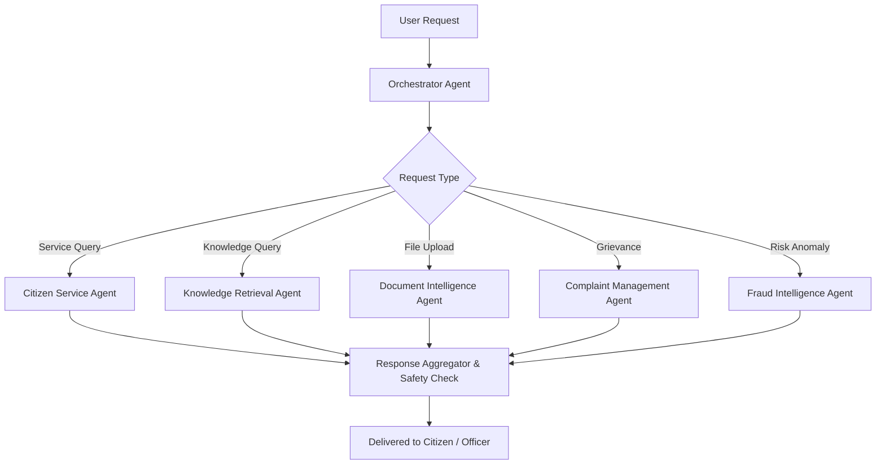

# GovAI Nexus – Complete System & Workflow Diagrams (Mermaid)

## 1. High-Level System Architecture

## 2. Authentication & Authorization Flow

## 3. Citizen Application Processing Flow

## 4. Intelligent Document Processing (OCR) Flow

## 5. RAG Question-Answering Flow

```mermaid
flowchart LR
    Q[Citizen Query: 'Income Certificate eligibility?'] --> Trans[Language & Intent Routing]
    Trans --> Embed[Generate Embedding: BGE-M3]
    Embed --> Retrieve[pgvector Cosine Search]
    Retrieve --> TopK[Top 5 Policy Chunks]
    TopK --> Rerank[Cross-Encoder Reranker]
    Rerank --> LLM[LLM Response Generation]
    LLM --> Cite[Validate Official G.O. References]
    Cite --> Output[Bilingual Answer with Verified Citations]
```

## 6. Multi-Agent Orchestration Flow

